# ဟိုတယ်နှင့်ခရီးသွားလာရေးဝန်ကြီးဌာန (MOCHT)
# အမျိုးသား ဒစ်ဂျစ်တယ် စာကြည့်တိုက် စီမံခန့်ခွဲမှုစနစ် (LMS)
## အသုံးပြုသူ လေ့ကျင့်ရေးနှင့် စနစ်အသုံးပြုနည်း ပြည့်စုံသော လမ်းညွှန်စာအုပ်
**National Library Management System — Comprehensive User & Admin Training Manual**

---

## 📌 စနစ်ဆိုင်ရာ အချက်အလက်များနှင့် မိတ်ဆက် (System Overview)

- **စနစ်အမည် (System Name):** ဟိုတယ်နှင့်ခရီးသွားလာရေးဝန်ကြီးဌာန၊ အမျိုးသား ဒစ်ဂျစ်တယ် စာကြည့်တိုက် စီမံခန့်ခွဲမှုစနစ် (MOCHT National Digital Library Access & Management System)
- **တရားဝင် လွှင့်တင်ထားသော လိပ်စာ (Live URL):** [http://206.189.47.42:3000](http://206.189.47.42:3000) (သို့မဟုတ် Nginx Gateway: [http://206.189.47.42:8080](http://206.189.47.42:8080))
- **အသုံးပြုထားသော နည်းပညာများ (Tech Stack):** Next.js 16 (App Router), TypeScript, Tailwind CSS, Prisma ORM, SQLite DB, Canvas 2D Barcode Engine, UTF-8 BOM CSV Export Engine
- **ရည်ရွယ်ချက် (Objective):** အပြည်ပြည်ဆိုင်ရာ Koha စံနှုန်းများနှင့်အညီ ပြည်သူလူထု (စာဖတ်သူအသင်းဝင်များ) နှင့် စာကြည့်တိုက်ဝန်ထမ်းများ (စာကြည့်တိုက်မှူးများ) အကြား ချောမွေ့စွာ ချိတ်ဆက်ဆောင်ရွက်နိုင်စေရန်၊ အွန်လိုင်းမှ စာအုပ်များ ရှာဖွေဖတ်ရှုနိုင်ရန် (OPAC & E-Book Viewer)၊ စာအုပ်ငှားရမ်း/အပ်နှံမှုနှင့် ဘားကုဒ်စနစ်များ ထိန်းချုပ်ရန်၊ စာအုပ်တစ်အုပ်ချင်းအလိုက် သီးခြား ဒဏ်ကြေးငွေ (MMK) တွက်ချက်ရန်၊ VIP အသင်းဝင် အထူးအခွင့်အရေးများနှင့် တရားဝင် အသင်းဝင်ကတ်ပြား (Member ID Pass) ထုတ်ယူနိုင်ရန် ပြည့်စုံစွာ ဖန်တီးထားသော စနစ်ဖြစ်ပါသည်။

---

# 📑 မာတိကာ (Table of Contents)

- [အပိုင်း (၁) - အများပြည်သူနှင့် စာဖတ်သူ အသင်းဝင်များဆိုင်ရာ စနစ် (Public Patron Portal)](#အပိုင်း-၁---အများပြည်သူနှင့်-စာဖတ်သူ-အသင်းဝင်များဆိုင်ရာ-စနစ်-public-patron-portal)
  - [လုပ်ဆောင်ချက် ၁ - အများပြည်သူသုံး စာအုပ်ရှာဖွေရေးစနစ် (OPAC Search & Category Filters)](#လုပ်ဆောင်ချက်-၁---အများပြည်သူသုံး-စာအုပ်ရှာဖွေရေးစနစ်-opac-search--category-filters)
  - [လုပ်ဆောင်ချက် ၂ - ဝဘ်ဘရောင်ဇာအတွင်း တိုက်ရိုက်ဖတ်ရှုနိုင်သော E-Book PDF ဖတ်စနစ် (In-Browser E-Book PDF Viewer)](#လုပ်ဆောင်ချက်-၂---ဝဘ်ဘရောင်ဇာအတွင်း-တိုက်ရိုက်ဖတ်ရှုနိုင်သော-e-book-pdf-ဖတ်စနစ်-in-browser-e-book-pdf-viewer)
  - [လုပ်ဆောင်ချက် ၃ - စနစ်သို့ အကောင့်ဝင်ရောက်ခြင်း (Member & Staff Authentication)](#လုပ်ဆောင်ချက်-၃---စနစ်သို့-အကောင့်ဝင်ရောက်ခြင်း-member--staff-authentication)
  - [လုပ်ဆောင်ချက် ၄ - စာဖတ်သူ အသင်းဝင် ပေါ်တယ်နှင့် သက်တမ်းတိုးခြင်း (Patron Portal & Self-Renewal)](#လုပ်ဆောင်ချက်-၄---စာဖတ်သူ-အသင်းဝင်-ပေါ်တယ်နှင့်-သက်တမ်းတိုးခြင်း-patron-portal--self-renewal)
- [အပိုင်း (၂) - စာကြည့်တိုက်မှူးနှင့် ဝန်ထမ်းများဆိုင်ရာ စီမံခန့်ခွဲမှုစနစ် (Staff Control Panel)](#အပိုင်း-၂---စာကြည့်တိုက်မှူးနှင့်-ဝန်ထမ်းများဆိုင်ရာ-စီမံခန့်ခွဲမှုစနစ်-staff-control-panel)
  - [လုပ်ဆောင်ချက် ၅ - စာကြည့်တိုက် ကွပ်ကဲမှု ဒက်ရှ်ဘုတ် (Staff Admin Command Center)](#လုပ်ဆောင်ချက်-၅---စာကြည့်တိုက်-ကွပ်ကဲမှု-ဒက်ရှ်ဘုတ်-staff-admin-command-center)
  - [လုပ်ဆောင်ချက် ၆ - စာအုပ်စာရင်းနှင့် ကတ်တလောက် စီမံခန့်ခွဲမှု (Catalog Management & Inventory)](#လုပ်ဆောင်ချက်-၆---စာအုပ်စာရင်းနှင့်-ကတ်တလောက်-စီမံခန့်ခွဲမှု-catalog-management--inventory)
  - [လုပ်ဆောင်ချက် ၇ - စာအုပ်အသစ်ထည့်သွင်းခြင်းနှင့် ဒဏ်ကြေးနှုန်း သတ်မှတ်ခြင်း (Add Book & Daily Fine Rate)](#လုပ်ဆောင်ချက်-၇---စာအုပ်အသစ်ထည့်သွင်းခြင်းနှင့်-ဒဏ်ကြေးနှုန်း-သတ်မှတ်ခြင်း-add-book--daily-fine-rate)
  - [လုပ်ဆောင်ချက် ၈ - စာအုပ်ကဏ္ဍခွဲများ စီမံခန့်ခွဲမှု (Book Category CRUD Management)](#လုပ်ဆောင်ချက်-၈---စာအုပ်ကဏ္ဍခွဲများ-စီမံခန့်ခွဲမှု-book-category-crud-management)
  - [လုပ်ဆောင်ချက် ၉ - စာအုပ်ငှားရမ်း/အပ်နှံ ကောင်တာနှင့် VIP အခွင့်အရေး (Circulation Desk & VIP +7 Days Rule)](#လုပ်ဆောင်ချက်-၉---စာအုပ်ငှားရမ်းအပ်နှံ-ကောင်တာနှင့်-vip-အခွင့်အရေး-circulation-desk--vip-7-days-rule)
  - [လုပ်ဆောင်ချက် ၁၀ - ဦးစားပေး ကြိုတင်မှာယူမှု စီမံခန့်ခွဲခြင်း (Priority Holds Queue Management)](#လုပ်ဆောင်ချက်-၁၀---ဦးစားပေး-ကြိုတင်မှာယူမှု-စီမံခန့်ခွဲခြင်း-priority-holds-queue-management)
  - [လုပ်ဆောင်ချက် ၁၁ - အသင်းဝင်များ စာရင်းနှင့် မှတ်ပုံတင်စိစစ်ခြင်း (Patron Directory & Myanmar NRC KYC)](#လုပ်ဆောင်ချက်-၁၁---အသင်းဝင်များ-စာရင်းနှင့်-မှတ်ပုံတင်စိစစ်ခြင်း-patron-directory--myanmar-nrc-kyc)
  - [လုပ်ဆောင်ချက် ၁၂ - တရားဝင် VIP အသင်းဝင်ကတ်ပြားနှင့် ပုံထုတ်ယူခြင်း (VIP Member Card Generation & PNG Export)](#လုပ်ဆောင်ချက်-၁၂---တရားဝင်-vip-အသင်းဝင်ကတ်ပြားနှင့်-ပုံထုတ်ယူခြင်း-vip-member-card-generation--png-export)
  - [လုပ်ဆောင်ချက် ၁၃ - ဒဏ်ကြေးစာရင်းနှင့် ငွေပေးချေမှု ကောက်ခံခြင်း (Fines Ledger & Payment Collection)](#လုပ်ဆောင်ချက်-၁၃---ဒဏ်ကြေးစာရင်းနှင့်-ငွေပေးချေမှု-ကောက်ခံခြင်း-fines-ledger--payment-collection)
- [အပိုင်း (၃) - အဆင့်မြင့် အစီရင်ခံစာနှင့် စာရင်းဇယား စနစ် (Reporting & Analytics Suite)](#အပိုင်း-၃---အဆင့်မြင့်-အစီရင်ခံစာနှင့်-စာရင်းဇယား-စနစ်-reporting--analytics-suite)
  - [လုပ်ဆောင်ချက် ၁၄ - စွမ်းဆောင်ရည် အနှစ်ချုပ်နှင့် Date Filter (Executive Summary & Date Filter)](#လုပ်ဆောင်ချက်-၁၄---စွမ်းဆောင်ရည်-အနှစ်ချုပ်နှင့်-date-filter-executive-summary--date-filter)
  - [လုပ်ဆောင်ချက် ၁၅ - ငှားရမ်းမှုမှတ်တမ်းနှင့် CSV ဒေါင်းလုဒ် (Circulation Loans Ledger & CSV Export)](#လုပ်ဆောင်ချက်-၁၅---ငှားရမ်းမှုမှတ်တမ်းနှင့်-csv-ဒေါင်းလုဒ်-circulation-loans-ledger--csv-export)
  - [လုပ်ဆောင်ချက် ၁၆ - ဒဏ်ကြေးငွေစာရင်းနှင့် CSV ဒေါင်းလုဒ် (Fines & Financial Ledger & CSV Export)](#လုပ်ဆောင်ချက်-၁၆---ဒဏ်ကြေးငွေစာရင်းနှင့်-csv-ဒေါင်းလုဒ်-fines--financial-ledger--csv-export)
  - [လုပ်ဆောင်ချက် ၁၇ - စာအုပ်လက်ကျန်စာရင်းနှင့် CSV ဒေါင်းလုဒ် (Catalog Inventory Status & CSV Export)](#လုပ်ဆောင်ချက်-၁၇---စာအုပ်လက်ကျန်စာရင်းနှင့်-csv-ဒေါင်းလုဒ်-catalog-inventory-status--csv-export)
  - [လုပ်ဆောင်ချက် ၁၈ - အသင်းဝင်များနှင့် VIP စာရင်း CSV ဒေါင်းလုဒ် (Patron & VIP Directory & CSV Export)](#လုပ်ဆောင်ချက်-၁၈---အသင်းဝင်များနှင့်-vip-စာရင်း-csv-ဒေါင်းလုဒ်-patron--vip-directory--csv-export)
  - [လုပ်ဆောင်ချက် ၁၉ - ရက်ကျော်လွန်စာအုပ်များ စာရင်းနှင့် CSV ဒေါင်းလုဒ် (Overdue Action List & CSV Export)](#လုပ်ဆောင်ချက်-၁၉---ရက်ကျော်လွန်စာအုပ်များ-စာရင်းနှင့်-csv-ဒေါင်းလုဒ်-overdue-action-list--csv-export)
- [အပိုင်း (၄) - Koha အဆင့်မြင့် လုပ်ငန်းဆောင်ရွက်ချက်များ (Koha Enterprise Library Services)](#အပိုင်း-၄---koha-အဆင့်မြင့်-လုပ်ငန်းဆောင်ရွက်ချက်များ-koha-enterprise-library-services)
  - [လုပ်ဆောင်ချက် ၂၀ - စာအုပ်ဝယ်ယူမှု စီမံခန့်ခွဲခြင်း (Acquisitions & Purchase Orders)](#လုပ်ဆောင်ချက်-၂၀---စာအုပ်ဝယ်ယူမှု-စီမံခန့်ခွဲခြင်း-acquisitions--purchase-orders)
  - [လုပ်ဆောင်ချက် ၂၁ - ဂျာနယ်နှင့် မဂ္ဂဇင်း စာရင်းသွင်းမှု (Serials & Periodicals)](#လုပ်ဆောင်ချက်-၂၁---ဂျာနယ်နှင့်-မဂ္ဂဇင်း-စာရင်းသွင်းမှု-serials--periodicals)
  - [လုပ်ဆောင်ချက် ၂၂ - စာကြည့်တိုက်အချင်းချင်း ချိတ်ဆက်ငှားရမ်းခြင်း (Interlibrary Loan - ILL)](#လုပ်ဆောင်ချက်-၂၂---စာကြည့်တိုက်အချင်းချင်း-ချိတ်ဆက်ငှားရမ်းခြင်း-interlibrary-loan---ill)
  - [လုပ်ဆောင်ချက် ၂၃ - တက္ကသိုလ် သင်ရိုးညွှန်းတမ်း စာအုပ်များ (Course Reserves)](#လုပ်ဆောင်ချက်-၂၃---တက္ကသိုလ်-သင်ရိုးညွှန်းတမ်း-စာအုပ်များ-course-reserves)
- [အပိုင်း (၅) - စံသတ်မှတ် လုပ်ငန်းလမ်းညွှန် (SOP) နှင့် အမေးများသော မေးခွန်းများ (FAQ)](#အပိုင်း-၅---စံသတ်မှတ်-လုပ်ငန်းလမ်းညွှန်-sop-နှင့်-အမေးများသော-မေးခွန်းများ-faq)

---

# အပိုင်း (၁) - အများပြည်သူနှင့် စာဖတ်သူ အသင်းဝင်များဆိုင်ရာ စနစ် (Public Patron Portal)

---

### လုပ်ဆောင်ချက် ၁ - အများပြည်သူသုံး စာအုပ်ရှာဖွေရေးစနစ် (OPAC Search & Category Filters)

**ရည်ရွယ်ချက်:** ပြည်သူလူထုနှင့် စာကြည့်တိုက် အသင်းဝင်များအနေဖြင့် စာကြည့်တိုက်တွင် ရှိသော မြန်မာဂန္ထဝင်စာပေများ၊ သမိုင်းစာအုပ်များ၊ နည်းပညာနှင့် ရသစာပေများကို လျင်မြန်လွယ်ကူစွာ ရှာဖွေနိုင်စေရန် ဖြစ်ပါသည်။

#### အဓိက အချက်များ-
1. **လျင်မြန်သော ရှာဖွေမှုစနစ် (Live Search):** စာအုပ်ခေါင်းစဉ်၊ စာရေးဆရာအမည်၊ ထုတ်ဝေသူ သို့မဟုတ် ISBN နံပါတ် ရိုက်ထည့်သည်နှင့် ချက်ချင်း ရှာဖွေဖော်ပြပေးပါသည်။
2. **စာအုပ်ကဏ္ဍခွဲ ပိုင်းခြားမှု (Category Pills):** `လူကြိုက်များ/ရေပန်းစား (Trending)`၊ `အသစ်ထွက်ရှိမှုများ (Latest release)`၊ `မြန်မာဂန္ထဝင်စာပေ`၊ `နည်းပညာနှင့် IT` စသည့် ကဏ္ဍခွဲ ခလုတ်များဖြင့် တစ်ချက်နှိပ်ရုံဖြင့် စစ်ထုတ်ကြည့်ရှုနိုင်ပါသည်။
3. **စာအုပ်လက်ကျန် အခြေအနေ ပြသမှု (Availability Status):** စင်ပေါ်တွင် ငှားရမ်းနိုင်သော စာအုပ်မိတ္တူ အရေအတွက် (Available) သို့မဟုတ် ငှားရမ်းထားဆဲ (Checked Out) အခြေအနေကို အစိမ်း/အပြာရောင် Badge ဖြင့် တိကျစွာ ပြသပေးပါသည်။
4. **အမျိုးသားစာကြည့်တိုက် E-Book အရင်းအမြစ် ခလုတ်:** အမျိုးသားစာကြည့်တိုက်၏ ဒစ်ဂျစ်တယ် အရင်းအမြစ်များဆီသို့ တိုက်ရိုက်သွားရောက်နိုင်သော လင့်ခ်ခလုတ် ပါဝင်ပါသည်။

#### အသုံးပြုနည်း အဆင့်ဆင့်-
1. ပင်မစာမျက်နှာ [http://206.189.47.42:3000/](http://206.189.47.42:3000/) သို့ ဝင်ရောက်ပါ။
2. ရှာဖွေရေးဘားတွင် မိမိရှာဖွေလိုသော စာအုပ်အမည် သို့မဟုတ် စာရေးဆရာ (ဥပမာ- "ဆရာကြီး ရွှေဥဒေါင်း" သို့မဟုတ် "ချစ်ဦးညို") ကို ရိုက်ထည့်ပါ။
3. မိမိစိတ်ဝင်စားရာ ကဏ္ဍခွဲခလုတ် (ဥပမာ- "🔥 လူကြိုက်များ/ရေပန်းစား") ကို နှိပ်၍ သီးသန့်ရွေးထုတ်ပါ။
4. စာအုပ်ကတ်ပြားပေါ်ရှိ အသေးစိတ် အချက်အလက်များ၊ ISBN နှင့် လက်ကျန်မိတ္တူ အရေအတွက်ကို ကြည့်ရှုပါ။

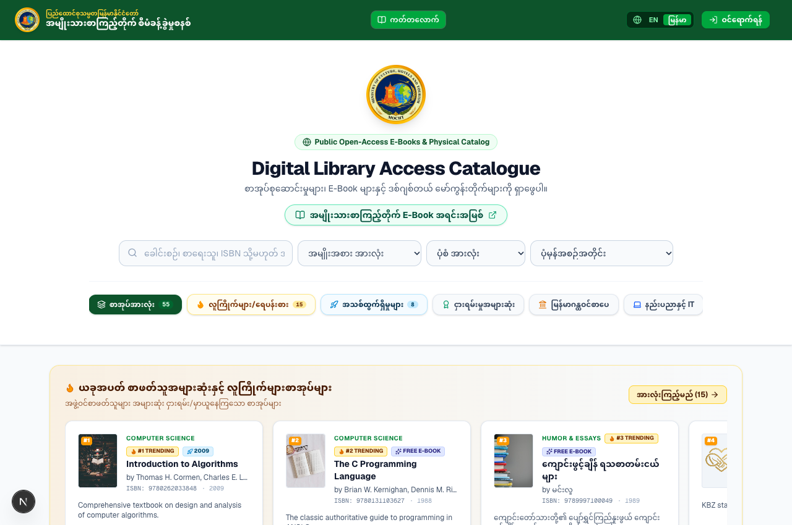
*ပုံ ၁ - OPAC ပင်မစာမျက်နှာတွင် စာအုပ်ရှာဖွေရေးဘား၊ အမျိုးအစား Filter များနှင့် ကဏ္ဍခွဲခလုတ်များ ဖော်ပြထားပုံ*

---

### လုပ်ဆောင်ချက် ၂ - ဝဘ်ဘရောင်ဇာအတွင်း တိုက်ရိုက်ဖတ်ရှုနိုင်သော E-Book PDF ဖတ်စနစ် (In-Browser E-Book PDF Viewer)

**ရည်ရွယ်ချက်:** ပြင်ပဆော့ဖ်ဝဲလ်များ သီးခြားဒေါင်းလုဒ်ဆွဲစရာမလိုဘဲ ကွန်ပျူတာ သို့မဟုတ် ဖုန်းဘရောင်ဇာပေါ်တွင် တိုက်ရိုက် E-Book PDF များကို ဖတ်ရှုနိုင်စေရန် ဖြစ်ပါသည်။

#### အဓိက အချက်များ-
1. **ကလစ်တစ်ချက်ဖြင့် ဖတ်ရှုနိုင်မှု (Instant Reading):** E-Book ရရှိနိုင်သော စာအုပ်များတွင် စိမ်းပြာရောင် **"PDF ဖတ်ရန်"** ခလုတ် ပေါ်နေမည် ဖြစ်ပါသည်။
2. **ပြည့်စုံသော Reader Controls:** စာမျက်နှာ အကူးအပြောင်း၊ Zoom In / Zoom Out ချဲ့ခြင်း/ချုံ့ခြင်း၊ မျက်နှာပြင်ပြည့် (Fit Width) ကြည့်ရှုခြင်းနှင့် ဒေါင်းလုဒ်ရယူခြင်းများကို စုံလင်စွာ ဆောင်ရွက်နိုင်ပါသည်။
3. **တရားဝင် E-Book စာအုပ် ၅၀ ကျော်:** ခေတ်ပေါ်နည်းပညာမှသည် မြန်မာ့သမိုင်းနှင့် ရသစာပေအထိ စာအုပ်ပေါင်း ၅၀ ကျော်ကို အပြည့်အစုံ ထည့်သွင်းပေးထားပါသည်။

#### အသုံးပြုနည်း အဆင့်ဆင့်-
1. စာအုပ်စာရင်းတွင် `FREE E-BOOK` အမှတ်အသားပါသော စာအုပ်ကို ရှာပါ။
2. စိမ်းပြာရောင် **"PDF ဖတ်ရန်"** ခလုတ်ကို နှိပ်ပါ။
3. မျက်နှာပြင်ပေါ်တွင် ပွင့်လာသော Reader Modal ဖြင့် စာအုပ်ကို စတင်ဖတ်ရှုပါ။
4. စာဖတ်ပြီးပါက ညာဘက်အပေါ်ထောင့်ရှိ "✕" (Close) ခလုတ်ကို နှိပ်၍ ပိတ်နိုင်ပါသည်။

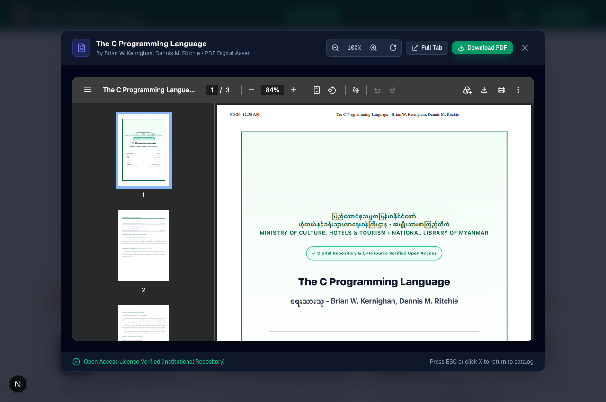
*ပုံ ၂ - ဝဘ်ဘရောင်ဇာအတွင်း တိုက်ရိုက်ဖတ်ရှုနိုင်သော မြန်မာ E-Book Reader Modal မျက်နှာပြင်*

---

### လုပ်ဆောင်ချက် ၃ - စနစ်သို့ အကောင့်ဝင်ရောက်ခြင်း (Member & Staff Authentication)

**ရည်ရွယ်ချက်:** စာကြည့်တိုက် အသင်းဝင်များနှင့် ဝန်ထမ်းများ မိမိတို့၏ သက်ဆိုင်ရာ အခန်းကဏ္ဍ (Role) အလိုက် လုံခြုံစွာ အကောင့်ဝင်ရောက်နိုင်စေရန် ဖြစ်ပါသည်။

#### အဓိက အချက်များ-
1. **အခန်းကဏ္ဍခွဲခြားမှု (Role-Based Access):** `Patron (စာဖတ်သူအသင်းဝင်)` နှင့် `Staff/Officer (စာကြည့်တိုက်မှူးနှင့် ဝန်ထမ်း)` ဟူ၍ နှစ်မျိုး ခွဲခြားထားပါသည်။
2. **လွယ်ကူသော Demo Login ခလုတ်များ:** စမ်းသပ်လေ့ကျင့်သူများ အဆင်ပြေစေရန် စာကြည့်တိုက်မှူးအကောင့် နှင့် အသင်းဝင်အကောင့်များအတွက် Quick Preset ခလုတ်များ ထည့်သွင်းထားပါသည်။
3. **ဘားကုဒ် သို့မဟုတ် အီးမေးလ်ဖြင့် ဝင်ရောက်နိုင်မှု:** မိမိ၏ အီးမေးလ် သို့မဟုတ် ကတ်ပြားပေါ်ရှိ ဘားကုဒ်နံပါတ် (ဥပမာ- `PAT-90022`) ဖြင့် အလွယ်တကူ Login ဝင်နိုင်ပါသည်။

#### အသုံးပြုနည်း အဆင့်ဆင့်-
1. အပေါ် Navigation Bar ရှိ **"အကောင့်ဝင်ရန် (Login)"** ကို နှိပ်ပါ။
2. မိမိဝင်ရောက်လိုသည့် အကောင့်အမျိုးအစား (Patron သို့မဟုတ် Staff) ကို ရွေးချယ်ပါ။
3. အီးမေးလ်နှင့် စကားဝှက် ရိုက်ထည့်ပြီး **"Sign In"** နှိပ်ပါ။

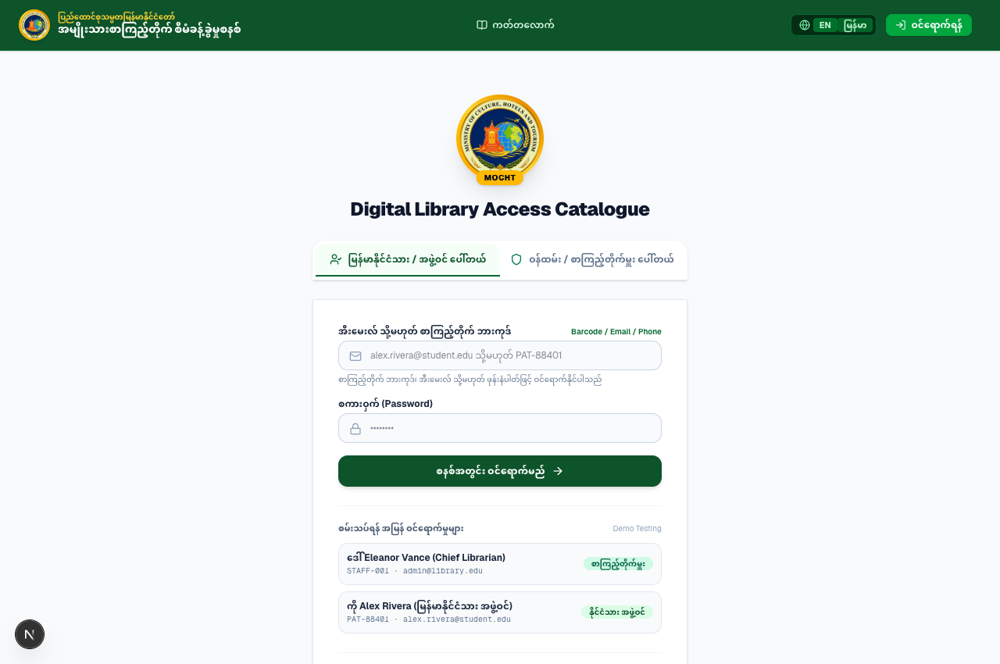
*ပုံ ၃ - အသင်းဝင်နှင့် ဝန်ထမ်းများ လုံခြုံစွာ အကောင့်ဝင်ရောက်နိုင်သော Login Portal*

---

### လုပ်ဆောင်ချက် ၄ - စာဖတ်သူ အသင်းဝင် ပေါ်တယ်နှင့် သက်တမ်းတိုးခြင်း (Patron Portal & Self-Renewal)

**ရည်ရွယ်ချက်:** စာဖတ်သူများ မိမိငှားရမ်းထားသော စာအုပ်စာရင်းများ၊ ပြန်အပ်ရမည့် ရက်စွဲများကို အချိန်နှင့်တစ်ပြေးညီ စစ်ဆေးနိုင်ပြီး အွန်လိုင်းမှတစ်ဆင့် စာအုပ်သက်တမ်းတိုးနိုင်စေရန် ဖြစ်ပါသည်။

#### အဓိက အချက်များ-
1. **လက်ရှိငှားရမ်းထားမှု အနှစ်ချုပ် (Current Checkouts):** ငှားရမ်းထားသည့် စာအုပ်အမည်၊ ငှားသည့်ရက်၊ ပြန်အပ်ရမည့်ရက်နှင့် ရက်လွန်ရန် ကျန်ရှိသည့် ရက်အရေအတွက်ကို ဖော်ပြပေးပါသည်။
2. **အွန်လိုင်းမှ စာအုပ်သက်တမ်းတိုးခြင်း (One-Click Self-Renewal):** စာကြည့်တိုက်သို့ လူကိုယ်တိုင် လာရောက်စရာမလိုဘဲ စာအုပ်ဘေးရှိ **"သက်တမ်းတိုးရန် (Renew Loan)"** ခလုတ်ကို နှိပ်၍ သတ်မှတ်ရက်အတိုင်း သက်တမ်းတိုးနိုင်ပါသည်။
3. **ကြိုတင်မှာယူမှု အခြေအနေ (Hold Tracking):** မိမိ ကြိုတင်မှာယူထားသော စာအုပ်များ၏ Queue အဆင့်နှင့် စာကြည့်တိုက်တွင် လာရောက်ထုတ်ယူနိုင်သည့် အခြေအနေကို စစ်ဆေးနိုင်ပါသည်။

#### အသုံးပြုနည်း အဆင့်ဆင့်-
1. အသင်းဝင်အကောင့်ဖြင့် Login ဝင်ပြီးနောက် **"အသင်းဝင် ပေါ်တယ် (Member Portal)"** သို့ သွားပါ။
2. "လက်ရှိငှားရမ်းထားသော စာအုပ်များ" စာရင်းတွင် ပြန်အပ်ရမည့်ရက်ကို ကြည့်ရှုပါ။
3. သက်တမ်းတိုးလိုပါက စိမ်းပြာရောင် **"သက်တမ်းတိုးရန်"** ခလုတ်ကို နှိပ်ပါ။

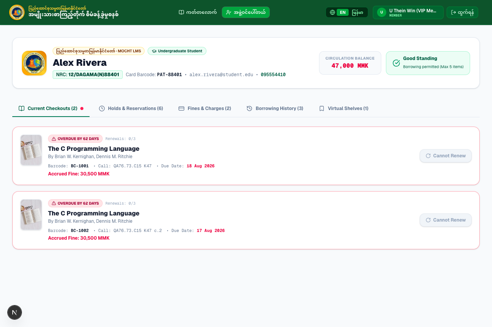
*ပုံ ၄ - စာဖတ်သူ အသင်းဝင် ပေါ်တယ်တွင် လက်ရှိငှားထားသော စာအုပ်များနှင့် သက်တမ်းတိုး ခလုတ်များ ဖော်ပြထားပုံ*

---

# အပိုင်း (၂) - စာကြည့်တိုက်မှူးနှင့် ဝန်ထမ်းများဆိုင်ရာ စီမံခန့်ခွဲမှုစနစ် (Staff Control Panel)

---

### လုပ်ဆောင်ချက် ၅ - စာကြည့်တိုက် ကွပ်ကဲမှု ဒက်ရှ်ဘုတ် (Staff Admin Command Center)

**ရည်ရွယ်ချက်:** စာကြည့်တိုက်မှူးများအတွက် စာကြည့်တိုက်တစ်ခုလုံး၏ လည်ပတ်မှုအခြေအနေ (စုစုပေါင်းစာအုပ်၊ ငှားရမ်းဆဲစာအုပ်၊ အသင်းဝင်ဦးရေ၊ ရရန်ကျန်ဒဏ်ကြေး) ကို မျက်ခြည်မပြတ် စောင့်ကြည့်ထိန်းချုပ်နိုင်စေရန် ဖြစ်ပါသည်။

#### အဓိက အချက်များ-
1. **အချိန်နှင့်တစ်ပြေးညီ KPI ကတ်ပြားများ:** စုစုပေါင်း စာအုပ်ခေါင်းစဉ်၊ လက်ရှိငှားထားသော စာအုပ်များ၊ မှတ်ပုံတင်ထားသော အသင်းဝင်ဦးရေနှင့် ကြိုတင်မှာယူမှု စာရင်းများ။
2. **အမြန်လုပ်ငန်းခလုတ်များ (Quick Shortcuts):** စာအုပ်ကတ်တလောက်သွင်းခြင်း၊ ငှား/ပြန်ကောင်တာ၊ အသင်းဝင်စာရင်း၊ ဒဏ်ကြေးစာရင်းနှင့် အစီရင်ခံစာများဆီသို့ တိုက်ရိုက်သွားရောက်နိုင်သော ခလုတ်များ။
3. **လတ်တလော လှုပ်ရှားမှု မှတ်တမ်း (Recent Activity Feed):** ယနေ့ စာအုပ်ငှားရမ်းမှု၊ ပြန်အပ်မှုနှင့် ဒဏ်ကြေးပေးသွင်းမှုများကို အချိန်မှတ်တမ်းနှင့်တကွ ပြသပေးပါသည်။

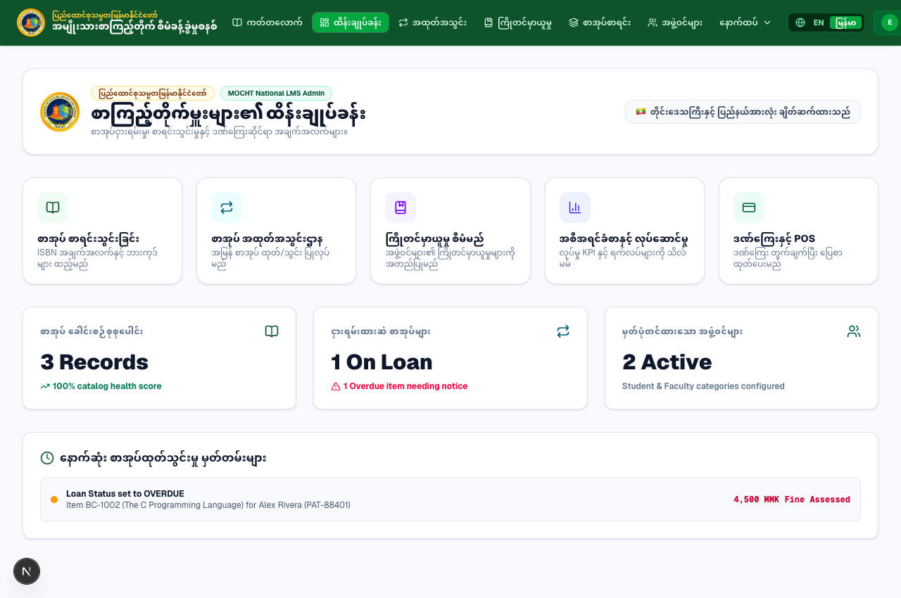
*ပုံ ၅ - စာကြည့်တိုက်မှူးများအတွက် အဓိက လုပ်ငန်းကွပ်ကဲမှု စင်တာ (Admin Dashboard)*

---

### လုပ်ဆောင်ချက် ၆ - စာအုပ်စာရင်းနှင့် ကတ်တလောက် စီမံခန့်ခွဲမှု (Catalog Management & Inventory)

**ရည်ရွယ်ချက်:** စာကြည့်တိုက်ရှိ စာအုပ်အသစ်များ ထည့်သွင်းခြင်း၊ ပြင်ဆင်ခြင်း၊ စာအုပ်မိတ္တူ (Physical Copies) များနှင့် စင်နံပါတ် (Shelf Location) များကို စနစ်တကျ စီမံခန့်ခွဲနိုင်စေရန် ဖြစ်ပါသည်။

#### အဓိက အချက်များ-
1. **ပြည့်စုံသော စာအုပ်ဇယား (Bibliographic Table):** စာအုပ်မျက်နှာဖုံး၊ ခေါင်းစဉ်၊ စာရေးဆရာ၊ ISBN၊ အမျိုးအစား၊ ကဏ္ဍခွဲ၊ မိတ္တူအရေအတွက်နှင့် ငှားရမ်းမှုကာလများကို တစ်နေရာတည်းတွင် ကြည့်ရှုနိုင်ပါသည်။
2. **စာအုပ်ကဏ္ဍ Filter များ (Category Tabs):** စာအုပ်များကို Trending၊ Latest Release စသည့် သတ်မှတ်ကဏ္ဍများအလိုက် စစ်ထုတ်ကြည့်ရှုနိုင်ပါသည်။
3. **မိတ္တူစီမံခန့်ခွဲမှု (Manage Copies):** စာအုပ်တစ်အုပ်ချင်းစီအတွက် ဘားကုဒ်နံပါတ်၊ ထားရှိရာ စင်နေရာ (ဥပမာ- Shelf B-12) နှင့် စာအုပ်အခြေအနေ (Available, On Loan, Maintenance, Lost) တို့ကို သီးခြားစီမံနိုင်ပါသည်။

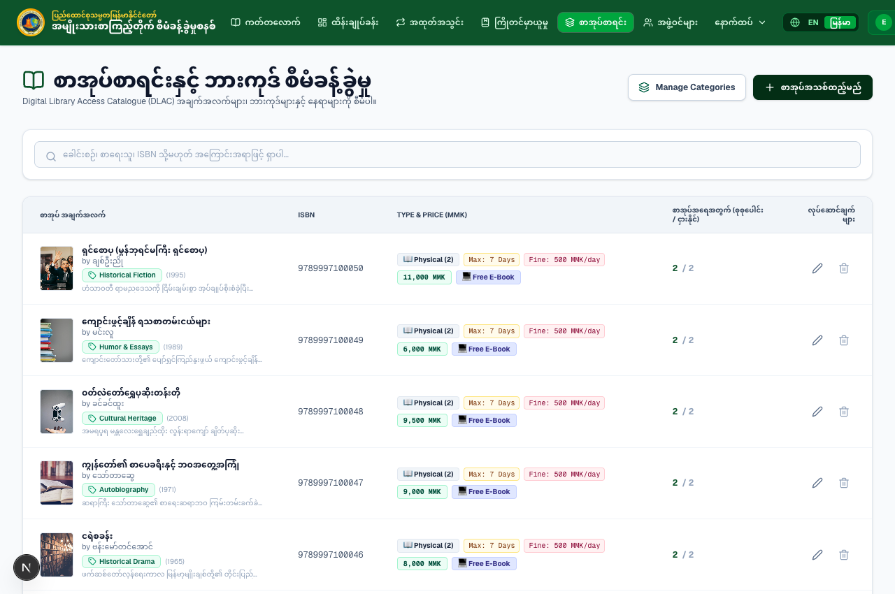
*ပုံ ၆ - စာအုပ်ကတ်တလောက် စာရင်းဇယားနှင့် ရှာဖွေစစ်ထုတ်မှု မျက်နှာပြင်*

---

### လုပ်ဆောင်ချက် ၇ - စာအုပ်အသစ်ထည့်သွင်းခြင်းနှင့် ဒဏ်ကြေးနှုန်း သတ်မှတ်ခြင်း (Add Book & Daily Fine Rate)

**ရည်ရွယ်ချက်:** စာအုပ်အသစ်တစ်အုပ် စနစ်ထဲသို့ ထည့်သွင်းရာတွင် သက်ဆိုင်ရာ ကဏ္ဍခွဲ (Category)၊ အများဆုံးငှားရမ်းနိုင်သော ရက်အရေအတွက်နှင့် ရက်လွန်ဒဏ်ကြေးနှုန်း (MMK/Day) တို့ကို စိတ်ကြိုက် သတ်မှတ်နိုင်စေရန် ဖြစ်ပါသည်။

#### အဓိက အချက်များ-
1. **စာအုပ်ကဏ္ဍခွဲ ရွေးချယ်မှု (Book Category Selection):** စာအုပ်ထည့်သွင်းချိန်တွင် သက်ဆိုင်ရာ Category (ဥပမာ- Trending, Latest release, Computer Science) ကို Dropdown မှ အလွယ်တကူ ရွေးချယ်နိုင်ပါသည်။
2. **အများဆုံးငှားရမ်းခွင့် ကာလ (Max Rent Days):** စံသတ်မှတ်ချက် ၇ ရက်အပြင် စာအုပ်အမျိုးအစားအလိုက် ၁၄ ရက်၊ ၂၁ ရက် စသဖြင့် ပြင်ဆင်သတ်မှတ်နိုင်ပါသည်။
3. **စာအုပ်အလိုက် သီးခြား ဒဏ်ကြေးနှုန်း (Daily Overdue Fine Rate in MMK):** တစ်ရက်လျှင် ကျသင့်မည့် ဒဏ်ကြေးငွေ (ဥပမာ- ၅၀၀ ကျပ်၊ ၁,၀၀၀ ကျပ်) ကို စာအုပ်တန်ဖိုးအလိုက် စိတ်ကြိုက်သတ်မှတ်နိုင်ပါသည်။

#### အသုံးပြုနည်း အဆင့်ဆင့်-
1. စာအုပ်စာရင်း စာမျက်နှာတွင် အစိမ်းရောင် **"+ စာအုပ်အသစ်ထည့်ရန်"** ခလုတ်ကို နှိပ်ပါ။
2. စာအုပ်ခေါင်းစဉ်၊ စာရေးဆရာ၊ ISBN၊ ထုတ်ဝေသူနှင့် အမျိုးအစားများကို ဖြည့်သွင်းပါ။
3. **Book Category** Dropdown တွင် သင့်လျော်သော ကဏ္ဍခွဲကို ရွေးပါ။
4. **အများဆုံး ငှားရမ်းနိုင်သည့်ရက် (Max Rent Days)** နှင့် **တစ်ရက် ဒဏ်ကြေးနှုန်း (Daily Fine Rate in MMK)** တို့ကို သတ်မှတ်ပါ။
5. **"သိမ်းဆည်းမည် (Save Book)"** ကို နှိပ်ပါ။

*ပုံ ၇ - စာအုပ်အသစ် ထည့်သွင်းခြင်းနှင့် ကဏ္ဍခွဲ၊ ဒဏ်ကြေးနှုန်း သတ်မှတ်သည့် ပုံစံ*

---

### လုပ်ဆောင်ချက် ၈ - စာအုပ်ကဏ္ဍခွဲများ စီမံခန့်ခွဲမှု (Book Category CRUD Management)

**ရည်ရွယ်ချက်:** စာကြည့်တိုက်မှူးများအနေဖြင့် စာအုပ်ကဏ္ဍခွဲအသစ်များ (Categories) ကို လိုအပ်သလို အသစ်ထည့်သွင်းခြင်း၊ အမည်ပြင်ဆင်ခြင်းနှင့် ဖျက်ပစ်ခြင်းများကို လွတ်လပ်စွာ ဆောင်ရွက်နိုင်စေရန် ဖြစ်ပါသည်။

#### အဓိက အချက်များ-
1. **လွတ်လပ်စွာ စီမံခန့်ခွဲနိုင်မှု (Full CRUD):** Create, Read, Update, Delete လုပ်ငန်းအားလုံးကို အလွယ်တကူ ဆောင်ရွက်နိုင်ပါသည်။
2. **ကဏ္ဍကုဒ်နှင့် ဖော်ပြချက် (Code & Description):** ကဏ္ဍအမည်အပြင် အတိုကောက်ကုဒ် (ဥပမာ- `TRENDING`, `LATEST`, `CS`) များကိုပါ စနစ်တကျ ထည့်သွင်းနိုင်ပါသည်။
3. **အလိုအလျောက် ချိတ်ဆက်မှု (Auto Integration):** ဤနေရာတွင် ထည့်သွင်းလိုက်သော Category များသည် ပင်မ OPAC ရှာဖွေရေးစာမျက်နှာနှင့် စာအုပ်ထည့်သွင်းသည့် Modal များတွင် ချက်ချင်း အလိုအလျောက် ပေါ်လာမည် ဖြစ်ပါသည်။

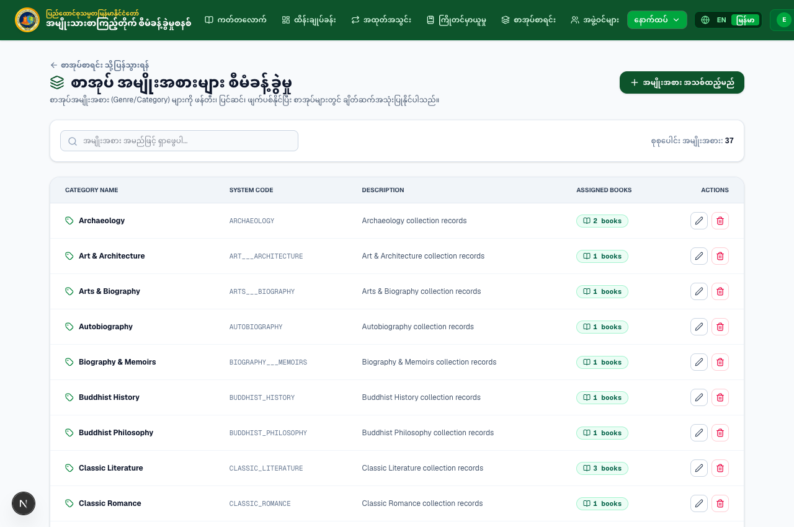
*ပုံ ၈ - စာအုပ်ကဏ္ဍခွဲများ အသစ်ထည့်သွင်းခြင်းနှင့် စီမံခန့်ခွဲသည့် မျက်နှာပြင်*

---

### လုပ်ဆောင်ချက် ၉ - စာအုပ်ငှားရမ်း/အပ်နှံ ကောင်တာနှင့် VIP အခွင့်အရေး (Circulation Desk & VIP +7 Days Rule)

**ရည်ရွယ်ချက်:** စာကြည့်တိုက် ကောင်တာတွင် စာအုပ်ငှားရမ်းခြင်းနှင့် ပြန်လည်အပ်နှံခြင်းများကို ဘားကုဒ် စကင်နာဖြင့် လျင်မြန်စွာ ဆောင်ရွက်နိုင်စေရန်နှင့် VIP အသင်းဝင်များအတွက် အထူးရက်ပို ခံစားခွင့်များ အလိုအလျောက် တွက်ချက်ပေးရန် ဖြစ်ပါသည်။

#### အဓိက အချက်များ-
1. **ဘားကုဒ်စကင်ဖတ်စနစ် (Barcode Scanner Ready):** အသင်းဝင်ကတ် ဘားကုဒ် (Patron Barcode) နှင့် စာအုပ်ဘားကုဒ် (Book Copy Barcode) တို့ကို စကင်ဖတ်ရုံဖြင့် စက္ကန့်ပိုင်းအတွင်း အချက်အလက်များ ကျရောက်လာပါသည်။
2. **VIP အသင်းဝင် အထူးရက်ပို စည်းမျဉ်း (+7 Days Loan Rule):**
   - စာဖတ်သူသည် **VIP အသင်းဝင်** ဖြစ်ပါက စာအုပ်ငှားရမ်းချိန်တွင် စံသတ်မှတ်ငှားရမ်းရက်ထက် **+7 ရက် ပိုမိုခံစားခွင့်** ရရှိမည် ဖြစ်ပါသည်။
   - ဥပမာ - သာမန်အသင်းဝင်အတွက် ၇ ရက်ငှားရမ်းခွင့်ရှိသော စာအုပ်ကို VIP အသင်းဝင် ငှားပါက **၁၄ ရက်** အလိုအလျောက် သတ်မှတ်ပေးပါသည်။
3. **အချိန်မှီ ဒဏ်ကြေးတွက်ချက်မှု (Real-Time Fine Calculation):** စာအုပ်ပြန်အပ်ချိန်တွင် သတ်မှတ်ရက် ကျော်လွန်နေပါက ရက်ကျော်လွန်သည့် ရက်အရေအတွက်နှင့် စာအုပ်၏ တစ်ရက်ဒဏ်ကြေးနှုန်းကို မြှောက်၍ ကျသင့်ဒဏ်ကြေးငွေ (MMK) ကို အလိုအလျောက် စာရင်းသွင်းပေးပါသည်။

#### အသုံးပြုနည်း အဆင့်ဆင့်-
1. **"စာအုပ် ငှား/ပြန် ကောင်တာ (Circulation Desk)"** သို့ သွားပါ။
2. **အသင်းဝင် ဘားကုဒ် (Patron Barcode)** ရိုက်ထည့်ပါ (ဥပမာ- `PAT-VIP-001`)။ အသင်းဝင်၏ VIP အဆင့်နှင့် လက်ရှိငှားထားသော စာအုပ်များကို ပြသပေးပါမည်။
3. **စာအုပ် မိတ္တူ ဘားကုဒ် (Copy Barcode)** ရိုက်ထည့်ပါ (ဥပမာ- `BK-001-C1`)။
4. စနစ်မှ စာအုပ်ငှားရမ်းခွင့် ရက်စွဲ (VIP ဖြစ်ပါက +7 ရက် ပေါင်းပြီးသား Due Date) ကို အစမ်းဖော်ပြပေးမည် ဖြစ်ပါသည်။
5. စိမ်းပြာရောင် **"စာအုပ်ငှားရမ်းမည် (Issue Loan)"** ခလုတ်ကို နှိပ်ပါ။

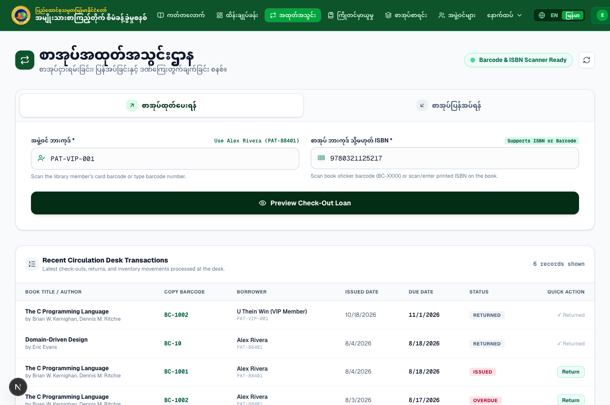
*ပုံ ၉ - စာအုပ် ငှား/ပြန် ကောင်တာတွင် VIP အသင်းဝင် အချက်အလက်နှင့် +7 ရက် ပေါင်းစပ်တွက်ချက်မှု မျက်နှာပြင်*

---

### လုပ်ဆောင်ချက် ၁၀ - ဦးစားပေး ကြိုတင်မှာယူမှု စီမံခန့်ခွဲခြင်း (Priority Holds Queue Management)

**ရည်ရွယ်ချက်:** စာအုပ်လက်ကျန်မရှိချိန်တွင် စာဖတ်သူများ ကြိုတင်မှာယူထားသော စာရင်းများကို Koha စံနှုန်းအတိုင်း ဦးစားပေးအဆင့် (Queue Priority) ဖြင့် ထိန်းချုပ်စီမံနိုင်စေရန် ဖြစ်ပါသည်။

#### အဓိက အချက်များ-
1. **ဦးစားပေး တန်းစီဇယား (Priority Ranking):** စောစီးစွာ မှာယူထားသူများကို ဦးစားပေးအဆင့် #1, #2 စသဖြင့် အစဉ်လိုက် သတ်မှတ်ပေးထားပါသည်။
2. **စာအုပ်ပြန်ရောက်ချိန် အသိပေးမှု:** ငှားရမ်းထားသော စာအုပ် ပြန်လည်အပ်နှံလိုက်သည်နှင့် အဆိုပါ စာအုပ်ကို နောက်ထပ်မှာယူထားသူထံ အလိုအလျောက် သီးသန့်ဖယ်ထားပေး (Reserved) ပါသည်။
3. **ထုတ်ပေးခြင်းနှင့် ပယ်ဖျက်ခြင်း (Fulfill & Cancel):** စာဖတ်သူ လာရောက်ထုတ်ယူပါက **"ထုတ်ပေးပြီး (Fulfill)"** နှိပ်နိုင်ပြီး လိုအပ်ပါက ပယ်ဖျက်နိုင်ပါသည်။

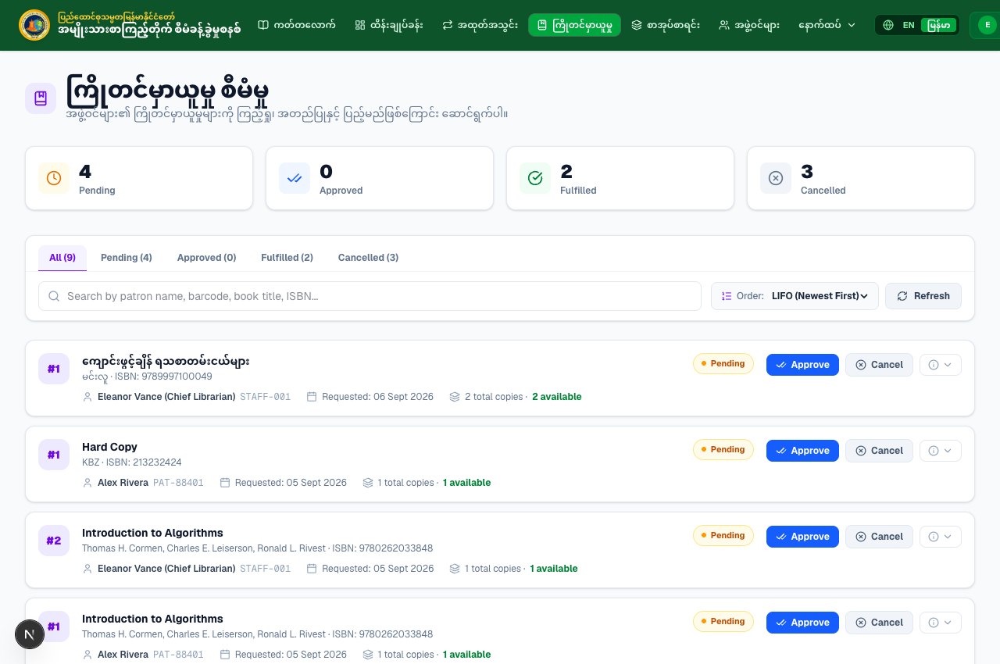
*ပုံ ၁၀ - ဦးစားပေး ကြိုတင်မှာယူမှု တန်းစီဇယား (Holds Queue)*

---

### လုပ်ဆောင်ချက် ၁၁ - အသင်းဝင်များ စာရင်းနှင့် မှတ်ပုံတင်စိစစ်ခြင်း (Patron Directory & Myanmar NRC KYC)

**ရည်ရွယ်ချက်:** စာကြည့်တိုက် အသင်းဝင်များ၏ အချက်အလက်များ၊ ဆက်သွယ်ရန်ဖုန်း၊ နိုင်ငံသားစိစစ်ရေးကတ်ပြား (NRC) နှင့် VIP အဆင့်အတန်းများကို စိစစ်အတည်ပြု စီမံခန့်ခွဲနိုင်စေရန် ဖြစ်ပါသည်။

#### အဓိက အချက်များ-
1. **မြန်မာနိုင်ငံသား မှတ်ပုံတင် စိစစ်မှု (Myanmar NRC Format):** ဥပမာ- `၁၂/လမန(နိုင်)၁၂၃၄၅၆` စသည့် မြန်မာနိုင်ငံသား မှတ်ပုံတင် ပုံစံဖြင့် စနစ်တကျ မှတ်တမ်းတင် စိစစ်နိုင်ပါသည်။
2. **VIP အသင်းဝင် အဆင့် သတ်မှတ်ခြင်း (VIP Status Toggle):** အသင်းဝင်တစ်ဦးချင်းစီကို သာမန်အသင်းဝင် (Standard) သို့မဟုတ် **VIP အသင်းဝင်** အဖြစ် Switch ခလုတ်လေးဖြင့် ချက်ချင်း ပြောင်းလဲသတ်မှတ်နိုင်ပါသည်။
3. **အကောင့်ပိတ်ပင်ခြင်း (Suspend/Block):** စာအုပ်ရက်လွန် ဒဏ်ကြေးများ ပေးဆောင်ရန် ပျက်ကွက်နေသူများကို အငှားရပ်ဆိုင်းထားနိုင်ပါသည်။

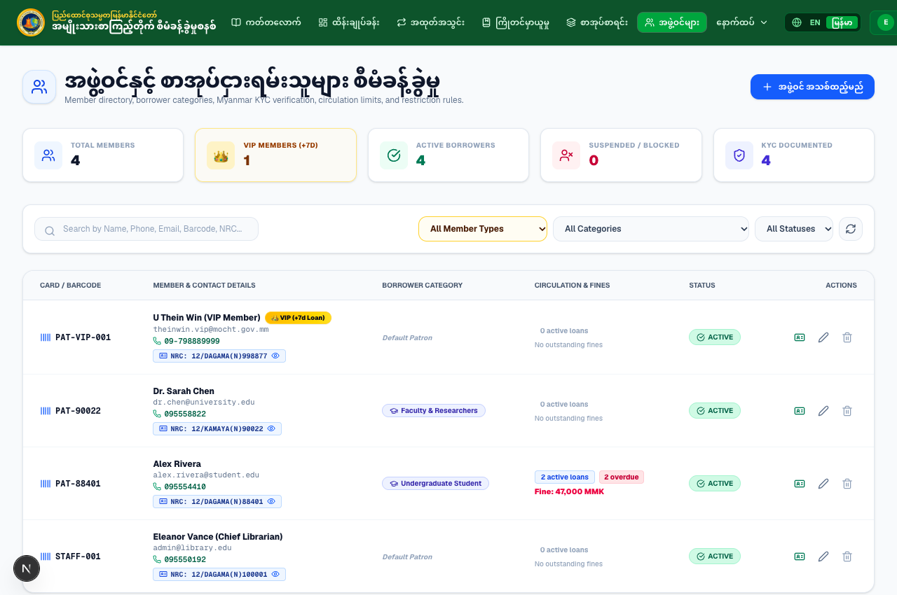
*ပုံ ၁၁ - အသင်းဝင်များ စာရင်း၊ VIP Badge များနှင့် NRC မှတ်ပုံတင် စိစစ်မှု မျက်နှာပြင်*

---

### လုပ်ဆောင်ချက် ၁၂ - တရားဝင် VIP အသင်းဝင်ကတ်ပြားနှင့် ပုံထုတ်ယူခြင်း (VIP Member Card Generation & PNG Export)

**ရည်ရွယ်ချက်:** အသင်းဝင်များအတွက် တရားဝင် နိုင်ငံတော်အဆင့် အသင်းဝင်ကတ်ပြားကို HTML5 Canvas နည်းပညာဖြင့် ဖန်တီးပေးပြီး ပုံနှိပ်ထုတ်ဝေနိုင်ရန် အရည်အသွေးမြင့် PNG ဖိုင်အဖြစ် ဒေါင်းလုဒ်ရယူနိုင်စေရန် ဖြစ်ပါသည်။

#### အဓိက အချက်များ-
1. **နိုင်ငံတော်အဆင့် ဇိမ်ခံဒီဇိုင်း (Luxury MOCHT Official Pass):** အစိမ်းရင့်ရောင်နှင့် ရွှေရောင်ပေါင်းစပ်ထားသော ဒီဇိုင်း၊ နိုင်ငံတော်အမှတ်တံဆိပ်၊ အသင်းဝင်ဘားကုဒ်၊ NRC နံပါတ်နှင့် သက်တမ်းကုန်ဆုံးရက်တို့ ပါဝင်ပါသည်။
2. **VIP သီးသန့် ရွှေရောင်ဘားနှင့် တံဆိပ် (VIP Gold Header & Crown):** VIP အသင်းဝင်များအတွက် ရွှေရောင်သရဖူတံဆိပ် (`👑 VIP MEMBER PASS`) နှင့် **"+7 Days Extended Loan Privilege"** ဟူသော စာတန်းကို အထူးထည့်သွင်းဖော်ပြပေးပါသည်။
3. **အရည်အသွေးမြင့် PNG ပုံထုတ်ယူခြင်း (High-Res 1050x660 PNG Export):** ကွန်ပျူတာ သို့မဟုတ် ပရင်တာဖြင့် PVC Card ရိုက်နှိပ်နိုင်ရန် ကြည်လင်ပြတ်သားသော PNG ဓာတ်ပုံဖိုင်အဖြစ် ကလစ်တစ်ချက်ဖြင့် ဒေါင်းလုဒ်ဆွဲနိုင်ပါသည်။

#### အသုံးပြုနည်း အဆင့်ဆင့်-
1. အသင်းဝင်စာရင်း စာမျက်နှာတွင် မိမိကတ်ထုတ်ယူလိုသော အသင်းဝင်၏ ဘေးရှိ အစိမ်းရောင် **"ကတ်ကြည့်ရန် (View Card)"** ကို နှိပ်ပါ။
2. မျက်နှာပြင်ပေါ်တွင် တရားဝင် MOCHT Member Pass Modal ပွင့်လာမည် ဖြစ်ပါသည်။
3. အပြာရောင် **"PNG ပုံထုတ်ယူရန် (Export as Image)"** ခလုတ်ကို နှိပ်ပါ။
4. ကွန်ပျူတာထဲသို့ `MemberCard_PAT-VIP-001_U_Thein_Win.png` ဟူသော ဖိုင်အမည်ဖြင့် ချက်ချင်း ဒေါင်းလုဒ်ကျရောက်လာမည် ဖြစ်ပါသည်။

*ပုံ ၁၂ - တရားဝင် VIP အသင်းဝင်ကတ်ပြား Modal နှင့် PNG ပုံထုတ်ယူသည့် ခလုတ်*

---

### လုပ်ဆောင်ချက် ၁၃ - ဒဏ်ကြေးစာရင်းနှင့် ငွေပေးချေမှု ကောက်ခံခြင်း (Fines Ledger & Payment Collection)

**ရည်ရွယ်ချက်:** စာအုပ်ရက်လွန်ဒဏ်ကြေးများ၊ စာအုပ်ပျောက်ဆုံး/ပျက်စီး ဒဏ်ကြေးများကို စာရင်းဇယားဖြင့် တိကျစွာ မှတ်တမ်းတင်ပြီး ကောင်တာတွင် ငွေကောက်ခံရှင်းလင်းနိုင်စေရန် ဖြစ်ပါသည်။

#### အဓိက အချက်များ-
1. **ဒဏ်ကြေးငွေ စာရင်းဇယား (Ledger Breakdown):** အသင်းဝင်အမည်၊ ဘားကုဒ်၊ သက်ဆိုင်ရာ စာအုပ်ခေါင်းစဉ်၊ ကျသင့်ငွေ (Amount in MMK)၊ ပေးပြီးငွေ (Paid)၊ ရရန်ကျန်ငွေ (Balance) နှင့် ဒဏ်ကြေးအခြေအနေ (UNPAID, PAID, WAIVED) တို့ကို ပြသပေးပါသည်။
2. **ငွေပေးချေမှု ကောက်ခံခြင်း (Collect Payment):** အပြည့်အဝ ပေးချေခြင်း သို့မဟုတ် အပိုင်းလိုက် ခွဲပေးခြင်း (Partial Payment) များကို လက်ခံဆောင်ရွက်နိုင်ပါသည်။
3. **ဒဏ်ကြေး ကင်းလွတ်ခွင့်ပြုခြင်း (Waive Fine):** အထူးကိစ္စရပ်များ သို့မဟုတ် ခိုင်လုံသောအကြောင်းပြချက်များအတွက် စာကြည့်တိုက်မှူး ခွင့်ပြုချက်ဖြင့် ဒဏ်ကြေးငွေ ကင်းလွတ်ခွင့် ပေးနိုင်ပါသည်။

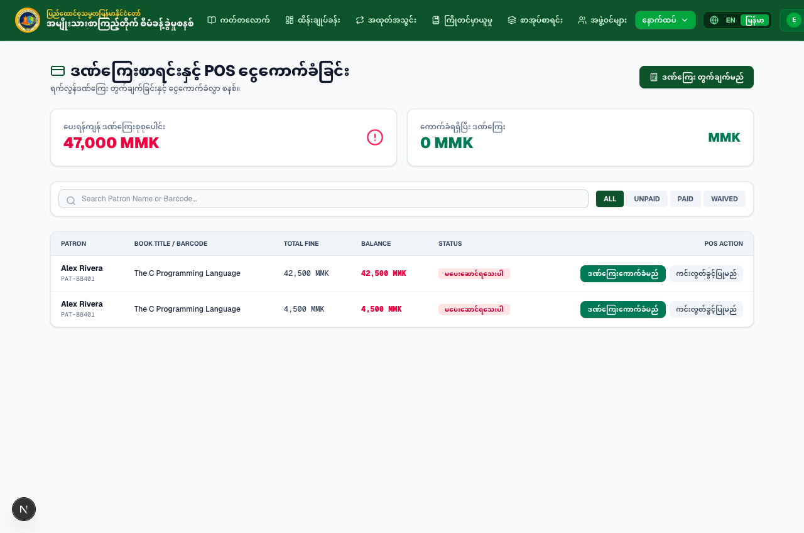
*ပုံ ၁၃ - ဒဏ်ကြေးစာရင်းဇယားနှင့် ငွေကောက်ခံခြင်း မျက်နှာပြင်*

---

# အပိုင်း (၃) - အဆင့်မြင့် အစီရင်ခံစာနှင့် စာရင်းဇယား စနစ် (Reporting & Analytics Suite)

---

### လုပ်ဆောင်ချက် ၁၄ - စွမ်းဆောင်ရည် အနှစ်ချုပ်နှင့် Date Filter (Executive Summary & Date Filter)

**ရည်ရွယ်ချက်:** စာကြည့်တိုက်၏ လုပ်ငန်းစွမ်းဆောင်ရည် အခြေအနေများကို ရက်စွဲကာလအလိုက် စစ်ထုတ်ကြည့်ရှုနိုင်ပြီး အနှစ်ချုပ် စာရင်းဇယားများကို လေ့လာဆန်းစစ်နိုင်စေရန် ဖြစ်ပါသည်။

#### အဓိက အချက်များ-
1. **ရက်စွဲ စစ်ထုတ်သည့် ကိရိယာ (Date Filter Presets & Custom Range):**
   - အမြန်ရွေးချယ်မှုများ: `၁၄ ရက်`၊ `၇ ရက်`၊ `၃၀ ရက်`၊ `ဒီလ`၊ `၃ လ`၊ `ယနေ့`၊ `မှတ်တမ်းအားလုံး`။
   - စိတ်ကြိုက်ရက်စွဲ: **"ရက်စွဲရွေးမည် (Custom)"** တွင် စတင်မည့်ရက် (From) နှင့် ပြီးဆုံးမည့်ရက် (To) ကို Date Picker ဖြင့် ရွေးချယ်ပြီး **Apply Range** နှိပ်နိုင်ပါသည်။
2. **အဓိက KPI ကတ်ပြား ၆ ခု (Fixed KPIs):** Total Titles, E-Resources, Active Members (VIP အပါအဝင်), Period Loans, Pending Holds, Outstanding Fines (NaN ပြဿနာ ကင်းစင်ပြီး တိကျသော MMK ဖော်ပြချက်)။
3. **ငှားရမ်းမှု ပြောင်းလဲချက်ဇယား (Dynamic Loan Trend Chart):** ရွေးချယ်ထားသော ရက်စွဲကာလအတွင်း တစ်ရက်ချင်းစီအလိုက် စာအုပ်ငှားရမ်းမှု အရေအတွက်ကို Bar Chart ဖြင့် ပုံဖော်ပေးပါသည်။
4. **စွမ်းဆောင်ရည် နှုန်းထားများ (Performance Rings):** စာအုပ်အသုံးချမှုနှုန်း (Utilization Rate)၊ ပြန်အပ်မှုနှုန်း (Return Rate)၊ ဒဏ်ကြေးကောက်ခံနှုန်း (Collection Rate) နှင့် ရက်ကျော်မှုနှုန်း (Overdue Rate)။

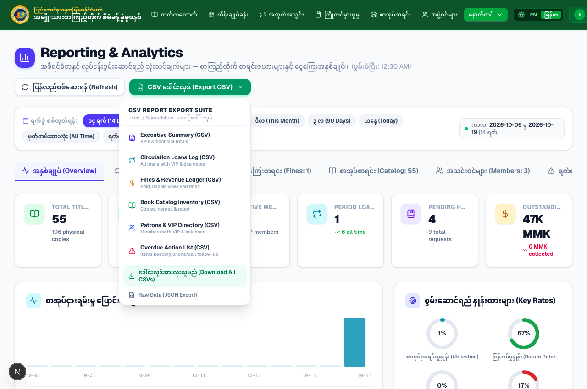
*ပုံ ၁၄ - Reporting & Analytics ပင်မစာမျက်နှာ၊ Date Filter Bar နှင့် CSV ဒေါင်းလုဒ် Dropdown Menu*

---

### လုပ်ဆောင်ချက် ၁၅ - ငှားရမ်းမှုမှတ်တမ်းနှင့် CSV ဒေါင်းလုဒ် (Circulation Loans Ledger & CSV Export)

**ရည်ရွယ်ချက်:** ရွေးချယ်ထားသော ရက်စွဲကာလအတွင်း ငှားရမ်းခဲ့သော မှတ်တမ်းအသေးစိတ်များကို ဇယားဖြင့် ကြည့်ရှုစစ်ဆေးနိုင်ပြီး Excel စာရင်းဇယားအဖြစ် ဒေါင်းလုဒ်ဆွဲနိုင်စေရန် ဖြစ်ပါသည်။

#### အဓိက အချက်များ-
1. **အသေးစိတ် စာရင်းဇယား:** အသင်းဝင်အမည်၊ VIP အဆင့်၊ ဘားကုဒ်၊ စာအုပ်ခေါင်းစဉ်၊ စာရေးဆရာ၊ မိတ္တူဘားကုဒ်၊ ငှားသည့်ရက်၊ ပြန်အပ်ရမည့်ရက်၊ အပ်နှံသည့်ရက်၊ အခြေအနေနှင့် သက်တမ်းတိုးကြိမ်ရေ။
2. **ရှာဖွေစစ်ထုတ်မှုစနစ်:** စာအုပ်အမည်၊ အသင်းဝင်အမည်ဖြင့် ရှာဖွေနိုင်ပြီး အခြေအနေအလိုက် (ISSUED, OVERDUE, RETURNED) စစ်ထုတ်နိုင်ပါသည်။
3. **တိုက်ရိုက် CSV ဒေါင်းလုဒ်:** ဇယားအပေါ်ရှိ **"ငှားရမ်းမှုမှတ်တမ်း CSV ဒေါင်းလုဒ်"** ခလုတ်ကို နှိပ်လိုက်သည်နှင့် UTF-8 BOM ပါဝင်သော CSV ဖိုင်အဖြစ် ချက်ချင်း ရရှိပါသည်။

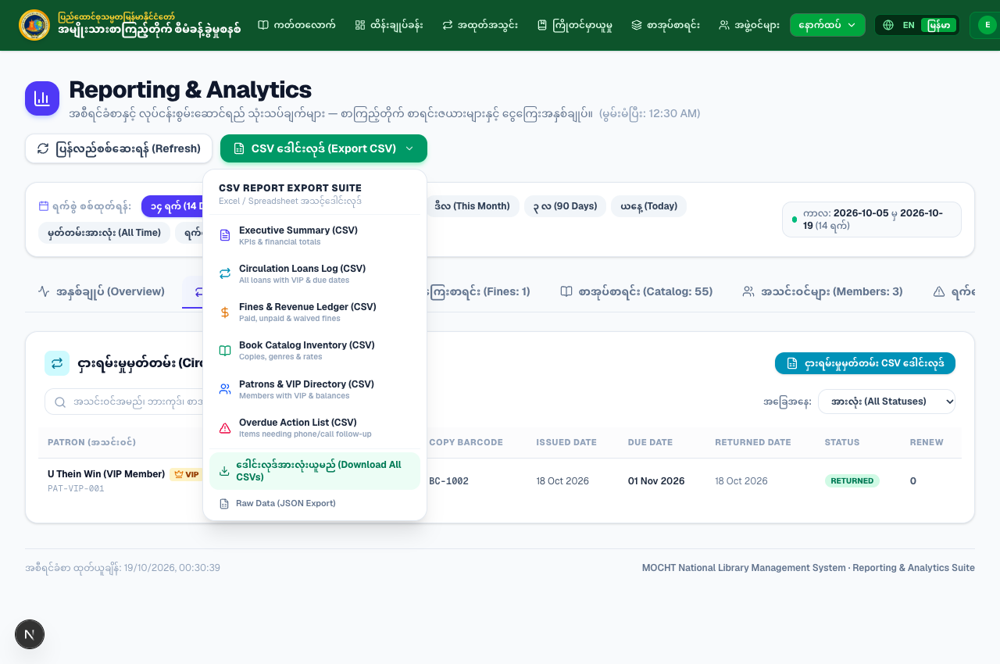
*ပုံ ၁၅ - စာအုပ်ငှားရမ်းမှု မှတ်တမ်းဇယားနှင့် သီးသန့် CSV ဒေါင်းလုဒ် ခလုတ်*

---

### လုပ်ဆောင်ချက် ၁၆ - ဒဏ်ကြေးငွေစာရင်းနှင့် CSV ဒေါင်းလုဒ် (Fines & Financial Ledger & CSV Export)

**ရည်ရွယ်ချက်:** စာကြည့်တိုက်မှ ကောက်ခံရရှိသော ငွေကြေးများနှင့် ရရန်ကျန် ဒဏ်ကြေးစာရင်းများကို ဘဏ္ဍာရေး အစီရင်ခံစာအဖြစ် စိစစ်ထုတ်ယူနိုင်စေရန် ဖြစ်ပါသည်။

#### အဓိက အချက်များ-
1. **ဘဏ္ဍာရေး အနှစ်ချုပ် ကတ်ပြားများ:** ကျသင့်ဒဏ်ကြေးစုစုပေါင်း (Total Incurred)၊ ကောက်ခံရရှိငွေ (Total Collected)၊ ရရန်ကျန်ဒဏ်ကြေး (Outstanding Balance)။
2. **ဒဏ်ကြေးစာရင်း အသေးစိတ်ဇယား:** အသင်းဝင်အချက်အလက်၊ စာအုပ်အမည်၊ ဒဏ်ကြေးဖြစ်ရသည့် အကြောင်းရင်း (Overdue, Lost Book, Damage)၊ ကျသင့်ငွေ၊ ပေးပြီးငွေ၊ ကျန်ငွေနှင့် ရက်စွဲ။
3. **တိုက်ရိုက် CSV ဒေါင်းလုဒ်:** **"ဒဏ်ကြေးစာရင်း CSV ဒေါင်းလုဒ်"** ခလုတ်ဖြင့် စာရင်းအင်းဌာနသို့ တင်ပြနိုင်သည့် Excel CSV ဖိုင်ကို ဒေါင်းလုဒ်ဆွဲနိုင်ပါသည်။

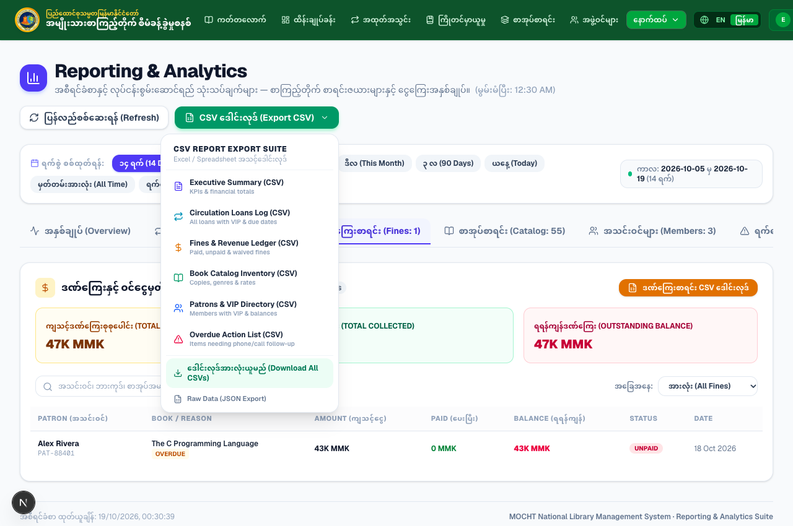
*ပုံ ၁၆ - ဒဏ်ကြေးနှင့် ဘဏ္ဍာရေး စာရင်းဇယား Tab*

---

### လုပ်ဆောင်ချက် ၁၇ - စာအုပ်လက်ကျန်စာရင်းနှင့် CSV ဒေါင်းလုဒ် (Catalog Inventory Status & CSV Export)

**ရည်ရွယ်ချက်:** စာကြည့်တိုက်ရှိ စာအုပ်ခေါင်းစဉ်များ၊ ရုပ်ပိုင်းဆိုင်ရာ မိတ္တူများ၊ စင်ပေါ်ရှိ/ငှားထားဆဲ အခြေအနေများကို စာရင်းစစ်ဆေးနိုင်ရန် ဖြစ်ပါသည်။

#### အဓိက အချက်များ-
1. **စာအုပ်လက်ကျန် အချက်အလက်များ:** စာအုပ်ခေါင်းစဉ်၊ စာရေးဆရာ၊ ISBN၊ အမျိုးအစား၊ စုစုပေါင်းမိတ္တူ (Total Copies)၊ စင်ပေါ်ရှိမိတ္တူ (Available)၊ ငှားထားဆဲမိတ္တူ (On Loan)၊ ငှားရမ်းခွင့်ရက်နှင့် တစ်ရက်ဒဏ်ကြေးနှုန်း။
2. **တိုက်ရိုက် CSV ဒေါင်းလုဒ်:** **"စာအုပ်စာရင်း CSV ဒေါင်းလုဒ်"** ခလုတ်ဖြင့် စာကြည့်တိုက် စာရင်းစစ် (Audit) အတွက် အသင့်သုံးနိုင်ပါသည်။

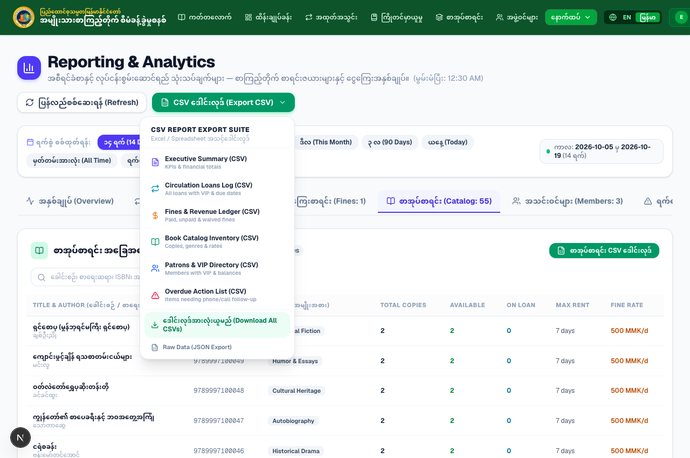
*ပုံ ၁၇ - စာအုပ်လက်ကျန်စာရင်း အခြေအနေနှင့် CSV ဒေါင်းလုဒ်*

---

### လုပ်ဆောင်ချက် ၁၈ - အသင်းဝင်များနှင့် VIP စာရင်း CSV ဒေါင်းလုဒ် (Patron & VIP Directory & CSV Export)

**ရည်ရွယ်ချက်:** စာကြည့်တိုက်တွင် မှတ်ပုံတင်ထားသော အသင်းဝင်အားလုံး၏ စာရင်း၊ VIP အဆင့်အတန်း၊ ဆက်သွယ်ရန်ဖုန်း၊ လက်ရှိငှားထားသော စာအုပ်များနှင့် ဒဏ်ကြေးကျန်ငွေများကို တစ်စုတစ်စည်းတည်း စစ်ဆေးနိုင်စေရန် ဖြစ်ပါသည်။

#### အဓိက အချက်များ-
1. **အသင်းဝင် အချက်အလက်ဇယား:** အသင်းဝင်အမည်၊ ဘားကုဒ်၊ အဆင့် (Standard သို့မဟုတ် VIP +7d)၊ အီးမေးလ်/ဖုန်း၊ စုစုပေါင်းငှားဖူးသည့် အကြိမ်ရေ၊ လက်ရှိငှားထားသော စာအုပ်အရေအတွက်၊ ရက်ကျော်စာအုပ်အရေအတွက်နှင့် အကောင့်အခြေအနေ (Active / Suspended)။
2. **တိုက်ရိုက် CSV ဒေါင်းလုဒ်:** **"အသင်းဝင်များ CSV ဒေါင်းလုဒ်"** ခလုတ်ဖြင့် အသင်းဝင်မှတ်ပုံတင် စာရင်းဇယားကို Excel သို့ ထုတ်ယူနိုင်ပါသည်။

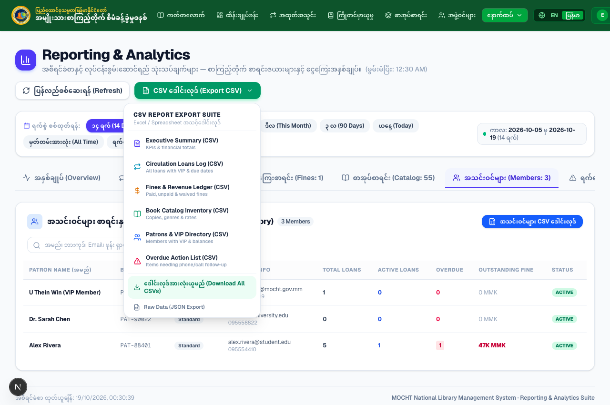
*ပုံ ၁၈ - အသင်းဝင်များနှင့် VIP စာရင်းဇယား Tab*

---

### လုပ်ဆောင်ချက် ၁၉ - ရက်ကျော်လွန်စာအုပ်များ စာရင်းနှင့် CSV ဒေါင်းလုဒ် (Overdue Action List & CSV Export)

**ရည်ရွယ်ချက်:** သတ်မှတ်ရက် ကျော်လွန်နေသော စာအုပ်များကို ချက်ချင်းဖော်ထုတ်ပြီး စာဖတ်သူထံ ဖုန်းဆက်၍ အမြန်ဆုံး ပြန်လည်အပ်နှံစေရန် ဆက်သွယ်ဆောင်ရွက်နိုင်စေရန် ဖြစ်ပါသည်။

#### အဓိက အချက်များ-
1. **လုပ်ဆောင်ရန် လိုအပ်သော ရက်လွန်စာရင်း (Action List):** အသင်းဝင်အမည်၊ ဘားကုဒ်၊ စာအုပ်ခေါင်းစဉ်၊ မိတ္တူဘားကုဒ်၊ ပြန်အပ်ရမည့်ရက်၊ ရက်လွန်နေသော ရက်အရေအတွက် (`7d`, `14d`+ အရောင်ကုဒ်များ)၊ ကျသင့်ဒဏ်ကြေးငွေနှင့် **ဆက်သွယ်ရန် ဖုန်းနံပါတ်**။
2. **တိုက်ရိုက် CSV ဒေါင်းလုဒ်:** **"ရက်ကျော်စာရင်း CSV ဒေါင်းလုဒ်"** ခလုတ်ဖြင့် စာအုပ်ပြန်လည်တောင်းခံရေး အဖွဲ့သားများ အသုံးပြုရန် Print ထုတ်ယူနိုင်ပါသည်။

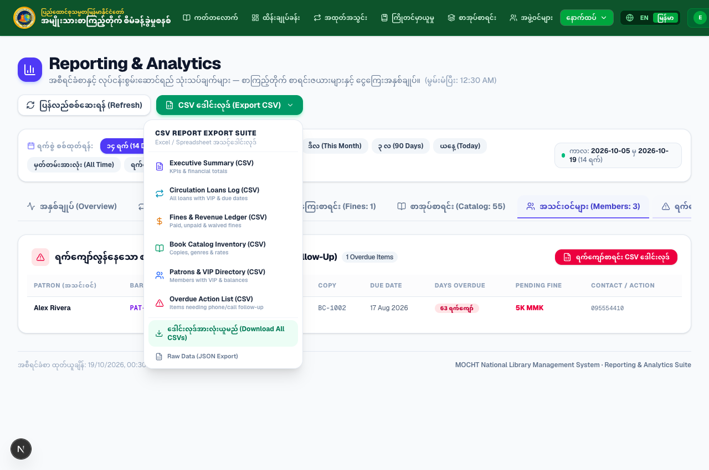
*ပုံ ၁၉ - ရက်ကျော်လွန်စာအုပ်များနှင့် ဆက်သွယ်ရန်ဖုန်းနံပါတ်ပါဝင်သော Overdue Action List*

---

# အပိုင်း (၄) - Koha အဆင့်မြင့် လုပ်ငန်းဆောင်ရွက်ချက်များ (Koha Enterprise Library Services)

---

### လုပ်ဆောင်ချက် ၂၀ - စာအုပ်ဝယ်ယူမှု စီမံခန့်ခွဲခြင်း (Acquisitions & Purchase Orders)

**ရည်ရွယ်ချက်:** စာကြည့်တိုက်အတွက် စာအုပ်အသစ်များ ဝယ်ယူရန် ဘတ်ဂျက်လျာထားခြင်း၊ ကုန်သည်များထံ အမှာစာ (Purchase Orders) တင်သွင်းခြင်းနှင့် စာအုပ်လက်ခံရရှိမှုများကို စနစ်တကျ မှတ်တမ်းတင်ရန် ဖြစ်ပါသည်။

#### အဓိက အချက်များ-
1. **ဘတ်ဂျက်ခြေရာခံမှု (Budget Tracking):** စုစုပေါင်းခွင့်ပြုဘတ်ဂျက်၊ သုံးစွဲပြီးငွေနှင့် လက်ကျန်ငွေများကို တိကျစွာ ပြသပေးပါသည်။
2. **အမှာစာ စီမံခန့်ခွဲမှု (PO Management):** အမှာစာတင်ခြင်း (Order Placed)၊ စာအုပ်လက်ခံရရှိခြင်း (Received) နှင့် ငွေပေးချေပြီးစီးခြင်း (Invoiced) အခြေအနေများကို အဆင့်လိုက် ထိန်းချုပ်နိုင်ပါသည်။

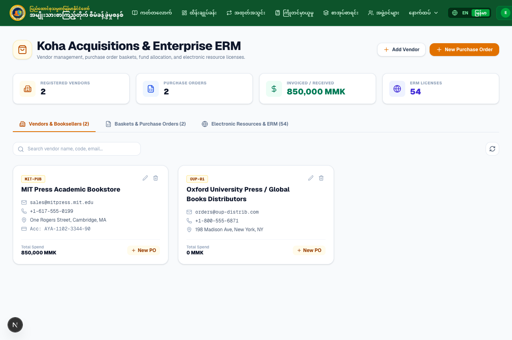
*ပုံ ၂၀ - စာအုပ်ဝယ်ယူမှု စီမံခန့်ခွဲခြင်းနှင့် ဘတ်ဂျက်ဇယား (Acquisitions)*

---

### လုပ်ဆောင်ချက် ၂၁ - ဂျာနယ်နှင့် မဂ္ဂဇင်း စာရင်းသွင်းမှု (Serials & Periodicals)

**ရည်ရွယ်ချက်:** နေ့စဉ်ထုတ် သတင်းစာများ၊ အပတ်စဉ်ဂျာနယ်များနှင့် လစဉ်ထုတ် မဂ္ဂဇင်းများကို စာရင်းသွင်း စီမံခန့်ခွဲနိုင်စေရန် ဖြစ်ပါသည်။

#### အဓိက အချက်များ-
1. **ထုတ်ဝေမှု အကြိမ်ရေ သတ်မှတ်ခြင်း (Frequency):** နေ့စဉ် (Daily)၊ အပတ်စဉ် (Weekly)၊ လစဉ် (Monthly)၊ နှစ်စဉ် (Annually) စသဖြင့် သတ်မှတ်နိုင်ပါသည်။
2. **ISSN နံပါတ် မှတ်တမ်းတင်ခြင်း:** အပြည်ပြည်ဆိုင်ရာ ဂျာနယ်စံသတ်မှတ်ကုဒ် (ISSN) ဖြင့် တိကျစွာ ရှာဖွေနိုင်ပါသည်။

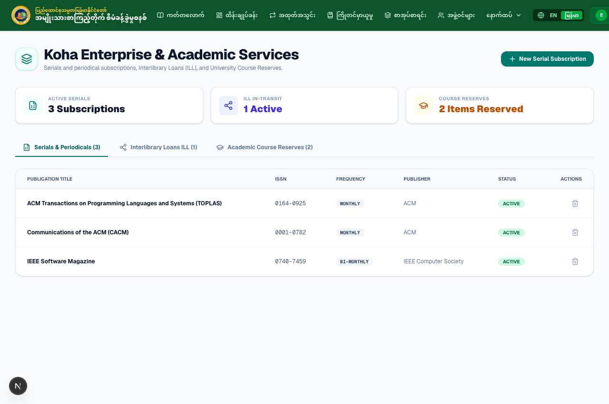
*ပုံ ၂၁ - ဂျာနယ်နှင့် မဂ္ဂဇင်း စာရင်းသွင်းခြင်း မျက်နှာပြင် (Serials)*

---

### လုပ်ဆောင်ချက် ၂၂ - စာကြည့်တိုက်အချင်းချင်း ချိတ်ဆက်ငှားရမ်းခြင်း (Interlibrary Loan - ILL)

**ရည်ရွယ်ချက်:** မိမိစာကြည့်တိုက်တွင် မရှိသော ရှားပါးစာအုပ်များကို အခြားမိတ်ဖက် တက္ကသိုလ်များနှင့် နိုင်ငံတော်စာကြည့်တိုက်များထံမှ တောင်းခံငှားရမ်းနိုင်စေရန် ဖြစ်ပါသည်။

#### အဓိက အချက်များ-
1. **မိတ်ဖက်စာကြည့်တိုက် ကွန်ရက် (Partner Libraries):** ရန်ကုန်တက္ကသိုလ်၊ မန္တလေးတက္ကသိုလ်၊ အမျိုးသားစာကြည့်တိုက် စသည့် မိတ်ဖက်အဖွဲ့အစည်းများနှင့် ချိတ်ဆက်တောင်းခံနိုင်ပါသည်။
2. **တောင်းခံမှု အခြေအနေ (Request Lifecycle):** တောင်းခံထားဆဲ (PENDING)၊ ပို့ဆောင်ဆဲ (IN_TRANSIT)၊ ရောက်ရှိလက်ခံရရှိ (RECEIVED) စသည့် အဆင့်များဖြင့် စောင့်ကြည့်နိုင်ပါသည်။

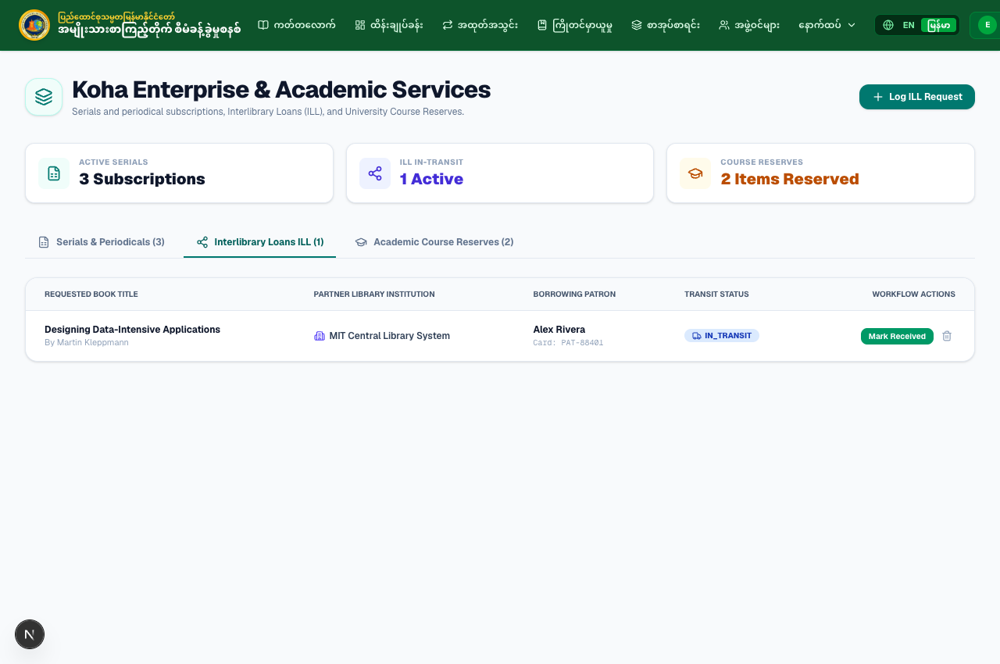
*ပုံ ၂၂ - စာကြည့်တိုက်အချင်းချင်း ချိတ်ဆက်ငှားရမ်းမှု စီမံခန့်ခွဲခြင်း (ILL)*

---

### လုပ်ဆောင်ချက် ၂၃ - တက္ကသိုလ် သင်ရိုးညွှန်းတမ်း စာအုပ်များ (Course Reserves)

**ရည်ရွယ်ချက်:** တက္ကသိုလ်နှင့် ကောလိပ် သင်တန်းများအတွက် သက်ဆိုင်ရာ ကထိက/ပါမောက္ခများ ညွှန်းဆိုထားသော မဖြစ်မနေဖတ်ရှုရမည့် စာအုပ်များကို သီးသန့်ဖယ်ထားပေးနိုင်စေရန် ဖြစ်ပါသည်။

#### အဓိက အချက်များ-
1. **ဘာသာရပ်ကုဒ်နှင့် ဆရာအမည် (Course Code & Instructor):** ဥပမာ- `CS-301: Advanced Algorithms (Dr. Win Maw)` စသဖြင့် ဘာသာရပ်အလိုက် စာရင်းသွင်းနိုင်ပါသည်။
2. **ကျောင်းသားများ ဦးစားပေး ဖတ်ရှုခွင့်:** သာမန်စာဖတ်သူများ ငှားရမ်းခွင့်ကို ကန့်သတ်ထားပြီး သက်ဆိုင်ရာ ဘာသာရပ်သင် ကျောင်းသားများသာ အဓိက ဖတ်ရှုနိုင်စေရန် ထိန်းချုပ်ထားနိုင်ပါသည်။

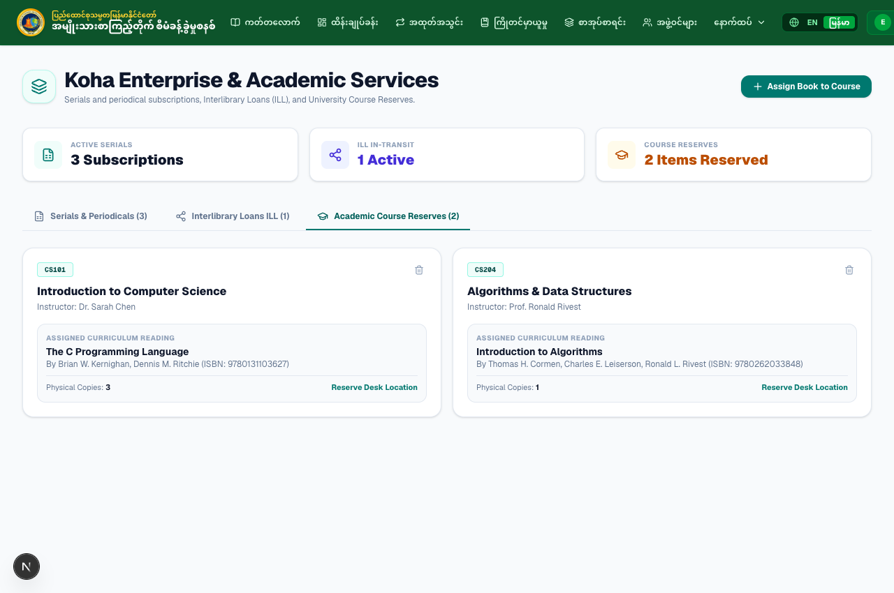
*ပုံ ၂၃ - တက္ကသိုလ် သင်ရိုးညွှန်းတမ်း သီးသန့်စာအုပ်များ စီမံခန့်ခွဲခြင်း (Course Reserves)*

---

# အပိုင်း (၅) - စံသတ်မှတ် လုပ်ငန်းလမ်းညွှန် (SOP) နှင့် အမေးများသော မေးခွန်းများ (FAQ)

---

### စာကြည့်တိုက်မှူးများအတွက် နေ့စဉ် လုပ်ငန်းလမ်းညွှန် (Daily SOP)

1. **နံနက်ခင်း လုပ်ငန်းစတင်ချိန် (Morning Opening Routine):**
   - စနစ်သို့ Staff အကောင့်ဖြင့် Login ဝင်ပါ။
   - Dashboard ပေါ်ရှိ **Pending Holds (စောင့်ဆိုင်းစာရင်း)** ကို စစ်ဆေးပြီး စင်ပေါ်မှ စာအုပ်များကို ထုတ်ယူကာ Reserved Shelf တွင် ထားရှိပါ။
   - **Reports ➔ ရက်ကျော်စာရင်း (Overdue Tab)** သို့ သွားရောက်၍ ၁၄ ရက်ထက်ကျော်လွန်နေသော အသင်းဝင်များထံ ဖုန်းဖြင့် ဆက်သွယ်အသိပေးပါ။
2. **နေ့လယ်ပိုင်း ကောင်တာလုပ်ငန်းများ (Circulation Desk Operations):**
   - စာအုပ်လာငှားသူတိုင်း၏ အသင်းဝင်ကတ် ဘားကုဒ်ကို အရင်စကင်ဖတ်ပါ။
   - VIP အသင်းဝင်ဖြစ်ပါက +7 ရက် ပိုမိုရရှိမည့် ရက်စွဲကို အသင်းဝင်အား ပြောကြားပေးပါ။
   - စာအုပ်ပြန်အပ်သူများထံမှ ရက်လွန်ဒဏ်ကြေးငွေ (ရှိပါက) ကောက်ခံပြီး ပြေစာမှတ်တမ်း ရယူပါ။
3. **ညနေခင်း လုပ်ငန်းသိမ်းချိန် (Evening Closing Routine):**
   - **Reports & Analytics** သို့ သွားပါ။
   - ရက်စွဲတွင် **"ယနေ့ (Today)"** ကို ရွေးချယ်ပါ။
   - **"Executive Summary (CSV)"** နှင့် **"Fines & Revenue Ledger (CSV)"** ကို ဒေါင်းလုဒ်ရယူ၍ နေ့စဉ်ငွေစာရင်းနှင့် ငှားရမ်းမှုစာရင်းကို စာရင်းကိုင်ဌာနသို့ တင်ပြပါ။

---

### အမေးများသော မေးခွန်းများ (Frequently Asked Questions - FAQ)

**မေး။ VIP အသင်းဝင်တစ်ဦးသည် စာအုပ်ငှားရမ်းပါက မည်မျှ ရက်ပိုရရှိပါသနည်း။**  
ဖြေ။ သာမန်အသင်းဝင်များထက် **+7 ရက်** ပိုမိုရရှိပါသည်။ ဥပမာ သာမန်စာအုပ်တစ်အုပ်၏ စံငှားရမ်းခွင့်သည် ၇ ရက်ဖြစ်ပါက VIP အသင်းဝင်အတွက် စနစ်မှ အလိုအလျောက် **၁၄ ရက်** ဟု သတ်မှတ်ပေးပါသည်။

**မေး။ ရက်လွန်ဒဏ်ကြေးငွေကို မည်သို့ တွက်ချက်ပါသနည်း။**  
ဖြေ။ စာအုပ်ပြန်အပ်ရမည့်ရက် (Due Date) ကျော်လွန်သွားသော ရက်အရေအတွက်နှင့် စာအုပ်ထည့်သွင်းစဉ်က သတ်မှတ်ထားသော တစ်ရက်ဒဏ်ကြေးနှုန်း (ဥပမာ- ၅၀၀ ကျပ်) ကို မြှောက်၍ အလိုအလျောက် တိကျစွာ တွက်ချက်ပေးပါသည်။ (စုစုပေါင်းဒဏ်ကြေး = ရက်လွန်ရက် × တစ်ရက်ဒဏ်ကြေးနှုန်း)။

**မေး။ CSV ဒေါင်းလုဒ်ဆွဲရာတွင် မြန်မာစာများ မှန်ကန်စွာ ပေါ်ပါသလား။**  
ဖြေ။ မှန်ကန်စွာ ပေါ်ပါသည်။ CSV ထုတ်ယူသည့် စနစ်တွင် **UTF-8 BOM (Byte Order Mark)** ပါဝင်အောင် တည်ဆောက်ထားသောကြောင့် Microsoft Excel, Google Sheets နှင့် LibreOffice တို့တွင် မြန်မာစာများ မပျက်မစီးဘဲ ရှင်းလင်းစွာ မြင်တွေ့နိုင်ပါသည်။

**မေး။ အသင်းဝင်ကတ်ပြားကို ပလတ်စတစ်ကတ် (PVC Card) ဖြင့် ပုံနှိပ်လိုပါက မည်သို့လုပ်ဆောင်ရမည်နည်း။**  
ဖြေ။ အသင်းဝင်စာရင်း (`/admin/patrons`) တွင် သက်ဆိုင်ရာ အသင်းဝင်၏ **"ကတ်ကြည့်ရန် (View Card)"** ကို နှိပ်ပြီး **"PNG ပုံထုတ်ယူရန် (Export as Image)"** ခလုတ်ကို နှိပ်ပါ။ စနစ်မှ $1050 \times 660$ pixel ရှိသော ကြည်လင်ပြတ်သားသည့် ဓာတ်ပုံဖိုင်ကို ထုတ်ပေးမည်ဖြစ်ပြီး မည်သည့် PVC Card Printer ဖြင့်မဆို တိုက်ရိုက် ပုံနှိပ်အသုံးပြုနိုင်ပါသည်။

---
*ဤလမ်းညွှန်စာအုပ်ကို ဟိုတယ်နှင့်ခရီးသွားလာရေးဝန်ကြီးဌာန၊ အမျိုးသား ဒစ်ဂျစ်တယ် စာကြည့်တိုက် စီမံခန့်ခွဲမှုစနစ်အတွက် အပြည့်အစုံ ရေးသားပြုစုထားပါသည်။*
